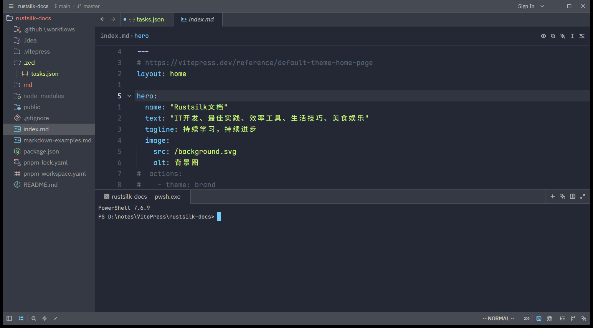

# 概述

Zed 的窗口由几个清晰的区域组成：**标题栏（Title Bar）**、中央的**编辑区（Editor / Panes）**、可折叠的三大 **dock（停靠面板）**，以及底部的**状态栏（Status Bar）**。理解这套布局，配合面板切换快捷键，就能高效组织你的工作区。

## 整体布局

```
┌──────────────────────────────────────────────────────────┐
│  Title Bar（标题栏：项目名 / 分支 / 用户菜单 / 布局切换）      │
├───────────┬──────────────────────────────────┬───────────┤
│           │   Tab Bar（标签栏：打开的 buffer）   │           │
│  左 Dock   │──────────────────────────────────│  右 Dock   │
│ Project   │                                    │ Agent     │
│ Panel     │        Editor（编辑区 / Panes）      │ Panel     │
│ Outline   │                                    │ Chat      │
│ Collab    │                                    │           │
├───────────┴──────────────────────────────────┴───────────┤
│  底部 Dock：Terminal（集成终端）                            │
├──────────────────────────────────────────────────────────┤
│  Status Bar（状态栏：语言 / 行列 / Git / 诊断 / 光标模式）   │
└──────────────────────────────────────────────────────────┘
```

下面是 rustsilk-docs 项目打开后的实际界面：左侧 Project Panel 文件树、中央编辑区（含面包屑与标签栏）、底部集成终端，以及右下角状态栏（Vim `-- NORMAL --` 模式、语言、行列等）。



## 标题栏（Title Bar）

标题栏左侧显示当前项目与 Git 分支，右侧是**用户菜单（头像）**。用户菜单里可以：

- 切换 **Panel Layout**（Classic / Agentic）
- 打开设置、主题、键位
- 登录 / 账号、切换更新通道
- 打开日志（`zed: open log`）

## 编辑区与 Panes

编辑区是核心。你可以把它**拆分成多个 pane（窗格）**并排显示不同文件：

- 拆分：`Ctrl+K` 然后方向键（macOS `Cmd+K` + 方向键），或命令面板搜 `pane: split ...`
- 在 pane 间移动焦点：`Ctrl+Alt+方向键`
- 每个 pane 有自己的 Tab Bar（标签栏），显示其中打开的 buffer

未聚焦的 pane 可以通过设置 `active_pane_modifiers.inactive_opacity` 变暗，帮助区分当前焦点。

## 三大 Dock

Dock 是可折叠的侧边/底部面板区。Zed 默认让它们「让位于代码」，用时再唤出。

| Dock | 位置 | 主要面板 | 切换快捷键 |
|------|------|----------|-----------|
| **左 Dock** | 左侧 | Project Panel（文件树）、Outline Panel（大纲）、Collab Panel（协作） | `Ctrl+B`（macOS `Cmd+B`） |
| **右 Dock** | 右侧 | Agent Panel（AI）、Chat Panel | `Ctrl+R` 或 `Ctrl+Alt+B`（macOS `Cmd+R`） |
| **底部 Dock** | 底部 | Terminal（集成终端） | `` Ctrl+` `` / `Ctrl+J` |

左 dock 内不同面板的切换：

- Project Panel（文件树）：`Ctrl+Shift+E`
- Outline Panel（大纲）：`Ctrl+Shift+B`（macOS `Cmd+Shift+B`）
- 具体见 [050.大纲面板与项目面板](../04.代码编辑与导航/050.大纲面板与项目面板.md)

## 状态栏（Status Bar）

底部状态栏从左到右通常显示：Git 分支与状态、诊断数量（错误/警告）、当前文件语言、光标行列位置、缩进/编码、以及 Vim 模式下的当前模式（Normal/Insert/Visual）。可通过设置 `status_bar.show` 隐藏。

## Tab Switcher（标签切换器）

Tab Switcher 提供在打开的标签间快速跳转的方式，按最近使用顺序排列。默认 `Ctrl+Tab`（或 `Ctrl+PageDown`）唤起，按住修饰键连续按可在列表中移动，松开即切换。详见 [040.核心快捷键速查](./040.核心快捷键速查.md)。

## Panel Layout：Classic vs Agentic

- **Classic（经典）**：编辑器优先，左 dock 放文件树，是传统开发默认。动作：`workspace: use classic layout`。
- **Agentic（智能体）**：把 Agent Panel 和 Threads Sidebar 并排放在左侧，方便一边看 AI 线程一边管理多个项目。动作：`workspace: use agentic layout`。

两者可随时在标题栏用户菜单里切换，见 [030.窗口与项目管理](./030.窗口与项目管理.md)。

# 引用

1. Getting Started（Panel Layout）：<https://zed.dev/docs/getting-started>
2. Project Panel：<https://zed.dev/docs/project-panel>
3. Outline Panel：<https://zed.dev/docs/outline-panel>
4. Tab Switcher：<https://zed.dev/docs/tab-switcher>
