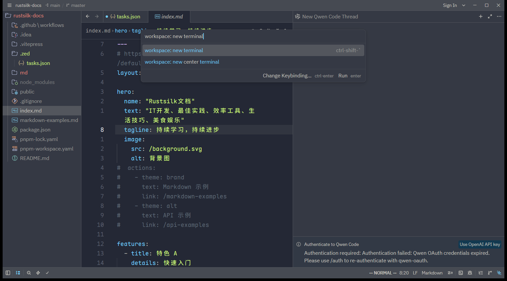

# 概述

**命令面板（Command Palette）** 是 Zed 的核心导航方式，也是你最先该记住的快捷键：`Ctrl+Shift+P`（macOS `Cmd+Shift+P`）。它是通往 Zed 里**每一个动作（action）**的入口——只要功能存在，就能在这里搜到并执行，搜索结果还会显示对应快捷键。

## 打开与使用

1. 按 `Ctrl+Shift+P` 打开命令面板。
2. 输入动作名的关键字，列表会**模糊匹配（fuzzy search）**实时收窄。
3. 用 `↑` `↓` 选择，`Enter` 执行。

例如输入 `new file`，列表会收窄到 `workspace: new file`，回车即新建一个 buffer。

下图是输入 `workspace: new terminal` 后的实时模糊匹配效果：列表收窄到匹配项，右侧直接显示其快捷键（`ctrl-shift-\``），底部提示 `Run enter`：

## 动作命名规律

Zed 的动作按「命名空间: 动作名」组织，常见命名空间：

| 前缀 | 含义 | 示例 |
|------|------|------|
| `zed:` | Zed 应用级动作 | `zed: open settings`、`zed: open keymap`、`zed: import vs code settings`、`zed: open log` |
| `workspace:` | 工作区级动作 | `workspace: new file`、`workspace: save`、`workspace: use classic layout` |
| `editor:` | 编辑器动作 | `editor: toggle soft wrap`、`editor: format` |
| `pane:` | 窗格动作 | `pane: split right`、`pane: close active item` |
| `project panel:` | 文件树动作 | `project panel: toggle focus` |
| `outline panel:` | 大纲动作 | `outline panel: toggle` |
| `terminal:` | 终端动作 | `terminal: toggle focus` |
| `agent:` | AI Agent 动作 | `agent: new thread` |
| `vim:` | Vim 模式动作 | `vim: backspace` |

> [!tip] 文档里的 `xxx: yyy` 都指命令面板
> 任何时候你在官方文档或本笔记里看到形如 `zed: ...`、`editor: ...` 的命令，意思都是「打开命令面板，搜索并执行它」。

## 常用命令速查

| 想做的事 | 搜索关键字 |
|----------|-----------|
| 打开设置文件 | `zed: open settings` |
| 打开键位文件 | `zed: open keymap` |
| 打开任务文件 | `zed: open tasks` |
| 打开日志（排查问题） | `zed: open log` |
| 重新加载扩展 | `zed: reload extensions` |
| 检查更新 | `zed: check for updates` |
| 从 VS Code 导入设置 | `zed: import vs code settings` |
| 切换布局 | `workspace: use classic layout` / `use agentic layout` |
| 保存全部 | `workspace: save all` |
| 格式化文档 | `editor: format` |

## 与 File Finder 的区别

命令面板（`Ctrl+Shift+P`）搜的是**动作/命令**；而 File Finder（`Ctrl+P`）搜的是**文件**（也可跳到符号、命令）。两者都是模糊搜索，但目标不同。File Finder 详见 [040.查找与导航](../04.代码编辑与导航/040.查找与导航.md)。

## 全部动作参考

Zed 提供了一份完整的动作清单，可在命令面板搜索或直接查阅官方 [All Actions](https://zed.dev/docs/all-actions)。本站对应笔记见 [040.设置与动作参考](../08.协作远程与参考/040.设置与动作参考.md)。

# 引用

1. Command Palette：<https://zed.dev/docs/command-palette>
2. All Actions：<https://zed.dev/docs/all-actions>
