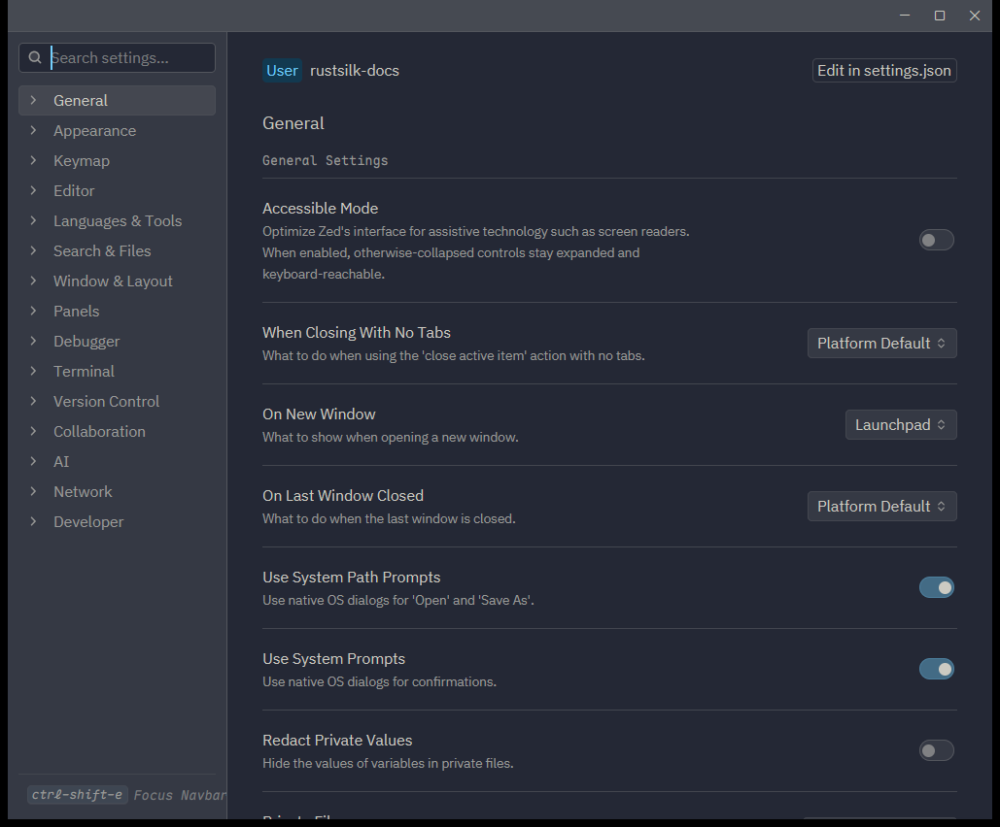

# 概述

Zed 的所有设置集中在 `settings.json`，它是一个 **JSONC** 文件（允许 `//` 注释与尾随逗号）。设置按**层级叠加**：越具体的层级优先级越高。理解这套体系，就能做到「全局一套默认、某项目单独覆盖、某语言再单独调」。

## 打开设置

| 方式 | 快捷键 / 命令 | 说明 |
|------|--------------|------|
| 设置编辑器（图形） | `Ctrl+,`（macOS `Cmd+,`） | 可搜索、点选修改，适合改常见项 |
| 设置文件（原始） | `Ctrl+Alt+,` 或 `zed: open settings` | 直接编辑 JSON，适合批量与版本管理 |
| 项目设置文件 | `zed: open project settings` | 编辑当前项目的 `.zed/settings.json` |

其中图形化设置编辑器（`Ctrl+,`）长这样：左侧是按分类（General / Appearance / Keymap / Editor …）的导航，右侧展示当前分类的设置项，可直接点选修改；右上角 `Edit in settings.json` 一键跳到原始 JSON：



## 设置层级与优先级

从低到高：

1. **内置默认值**：Zed 自带。
2. **用户全局设置**：`~/.config/zed/settings.json`（Windows：`~\AppData\Roaming\Zed\settings.json`）。
3. **项目设置**：项目根目录下 `.zed/settings.json`，随仓库提交，团队共享。
4. **项目本地设置**：`.zed/settings.local.json`，默认被 git 忽略，只影响你自己。

高优先级层会**深合并（deep merge）**覆盖低层的同名字段。

## 基本结构

`settings.json` 是一个大对象，顶层是全局设置，`languages` 下是语言级设置：

```jsonc
{
  // —— 全局设置 ——
  "theme": "One Dark",
  "buffer_font_family": "Zed Plex Mono",
  "buffer_font_size": 15,
  "tab_size": 2,
  "format_on_save": "on",
  "vim_mode": false,

  // —— 语言级设置 ——
  "languages": {
    "Rust": {
      "tab_size": 4,
      "format_on_save": "on"
    },
    "Python": {
      "tab_size": 4,
      "language_servers": ["pyright", "ruff"]
    },
    "JSON": {
      "tab_size": 2
    }
  }
}
```

## 按发布通道覆盖

如果你同时使用 stable / preview / nightly，可以为不同通道设置不同值。通道专属设置写在对应的顶层键下：

```jsonc
{
  "theme": "One Dark",
  "vim_mode": false,
  "nightly": {
    "theme": "One Light",
    "vim_mode": true
  },
  "preview": {
    "theme": "One Dark"
  }
}
```

## 常用设置项速览

| 设置项 | 作用 | 常见取值 |
|--------|------|----------|
| `theme` | 主题 | 主题名字符串，或 `{ "mode": "system", "light": ..., "dark": ... }` |
| `buffer_font_family` | 编辑区字体 | 字体名，默认 `Zed Mono` / `Zed Plex Mono` |
| `buffer_font_size` | 编辑区字号（像素） | 数字 |
| `tab_size` | 缩进宽度 | 数字 |
| `hard_tabs` | 用 Tab 字符而非空格 | `true` / `false` |
| `soft_wrap` | 软换行 | `"none"` / `"editor_width"` / `"preferred_line_length"` |
| `format_on_save` | 保存时格式化 | `"on"` / `"off"` / `"language_server"` / `{ "external": ... }` |
| `cursor_shape` | 光标形状 | `"bar"` / `"block"` / `"underline"` / `"hollow"` |
| `current_line_highlight` | 高亮当前行 | `true` / `false` |
| `relative_line_numbers` | 相对行号 | `"disabled"` / `"enabled"` / `"wrapped"` |
| `minimap` | 小地图 | 对象，如 `{ "show": "auto" }` |
| `vim_mode` | 启用 Vim 模式 | `true` / `false`（默认 `false`） |
| `helix_mode` | 启用 Helix 模式（会同时启用 vim_mode） | `true` / `false` |
| `base_keymap` | 基础键位方案 | `"VSCode"` / `"Atom"` / `"JetBrains"` / `"SublimeText"` / `"Emacs"` / `"Cursor"` / `"TextMate"` / `"None"` |
| `autosave` | 自动保存 | `"off"` / `"on_focus_change"` / `"on_window_change"` / `{ "milliseconds": ... }` |
| `telemetry` | 遥测 | `{ "diagnostics": false, "metrics": false }` |
| `show_edit_predictions` | 显示编辑预测 | `true` / `false` |

> [!tip] 完整设置清单
> 所有设置项及默认值见官方 [All Settings](https://zed.dev/docs/reference/all-settings)。本站对应笔记见 [040.设置与动作参考](../08.协作远程与参考/040.设置与动作参考.md)。在设置编辑器里搜索关键字，是发现设置项最快的方式。

## 项目级设置示例

在项目根目录建 `.zed/settings.json`，可让团队成员共享一致的编辑器行为：

```jsonc
{
  "tab_size": 4,
  "format_on_save": "on",
  "languages": {
    "Python": {
      "language_servers": ["pyright", "ruff"],
      "format_on_save": "on"
    }
  },
  "lsp": {
    "rust-analyzer": {
      // 仅为语法演示；保存时诊断默认用 cargo check（社区主流），clippy 建议放 CI，见 060
      "check": { "command": "clippy" }
    }
  }
}
```

把不希望提交的个人偏好放进 `.zed/settings.local.json`（默认被忽略）。

> [!tip] 拿来即用
> 想要一套覆盖 Rust / Java / C/C++ / Python / 前端、风格对齐 IntelliJ 全家桶的完整模板，直接复制 [060.最佳实践完整配置](./060.最佳实践完整配置.md)。

## JSONC 小贴士

- 支持 `//` 行注释与 `/* */` 块注释。
- 允许尾随逗号。
- 改完**即时生效**，无需重启（多数设置）；部分设置（如某些语言服务器）可能需要重新加载窗口。

# 引用

1. Configuring Zed：<https://zed.dev/docs/configuring-zed>
2. All Settings：<https://zed.dev/docs/reference/all-settings>
