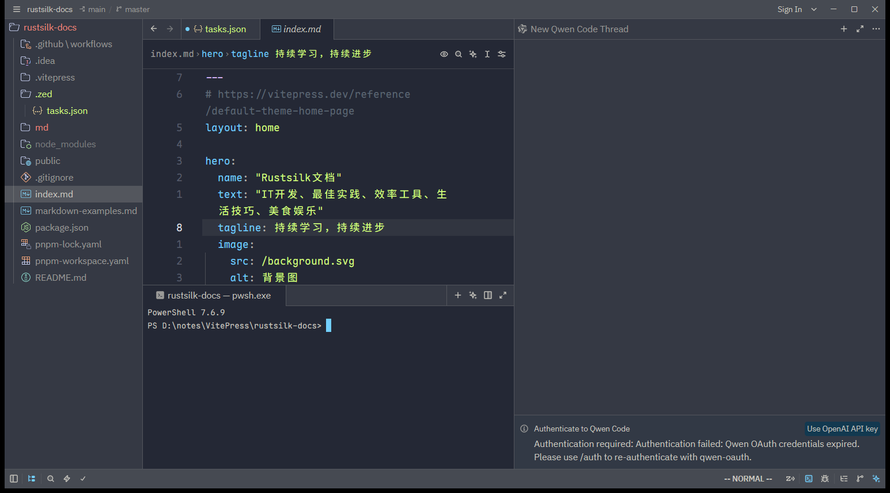

# 概述

Zed 内置了一个功能完整的**终端模拟器（Terminal）**，支持多终端实例、自定义 shell、以及与编辑器的深度集成（如点击输出里的文件路径直接跳转）。你不必再单独开一个终端窗口。

## 打开终端

| 动作 | Windows / Linux | macOS |
|------|-----------------|-------|
| 切换终端面板（Toggle terminal panel） | `` Ctrl+` `` | `` Ctrl+` `` |
| 新建终端（Open new terminal） | `Ctrl+~` | `Ctrl+~` |
| 在中心区打开终端 | 命令面板 | 命令面板 |

也可以在命令面板执行 `terminal panel: toggle` 或 `workspace: new terminal`。

> [!note] 反引号键位
> `` Ctrl+` `` 里的 `` ` `` 是键盘左上角 Esc 下方、数字 1 左边那个反引号键（与 `~` 同键）。这也是 VS Code 用户熟悉的终端快捷键。

下图是终端面板开在底部的样子（一个 PowerShell 7 会话，工作目录自动定位到项目根）：



## 终端面板 vs 中心终端

Zed 提供两种终端摆放方式：

- **Terminal Panel（终端面板）**：默认停靠在工作区底部（也可设为左/右），用 `` Ctrl+` `` 切换显隐。适合边写边跑命令。
- **Center Pane（中心终端）**：像普通文件标签一样开在编辑区中央。命令面板执行 `workspace: new center terminal` 打开。适合长时间运行的 TUI 程序（如 `lazygit`、`htop`）。

## 多终端与分屏

在终端面板聚焦时：

| 操作 | Windows / Linux | macOS |
|------|-----------------|-------|
| 新建终端标签 | `Ctrl+N` | `Cmd+N` |
| 水平分屏 | `Ctrl+Shift+5` | `Cmd+D` |

每个终端在面板里显示为一个标签，可自由切换。

## 配置 shell

默认使用系统默认 shell（Unix 下取自 `/etc/passwd`；Windows 下通常是 PowerShell）。要指定其它 shell：

```jsonc
{
  "terminal": {
    "shell": {
      "program": "/bin/zsh"
    }
  }
}
```

带参数启动：

```jsonc
{
  "terminal": {
    "shell": {
      "with_arguments": {
        "program": "/bin/bash",
        "args": ["--login"]
      }
    }
  }
}
```

## 工作目录

控制新终端从哪个目录启动：

| 取值 | 行为 |
|------|------|
| `"current_file_directory"` | 当前文件所在目录，回退到项目目录，再回退到工作区第一个项目 |
| `"current_project_directory"` | 当前文件所属项目目录（**默认**） |
| `"first_project_directory"` | 工作区里的第一个项目 |
| `"always_home"` | 总是从用户主目录启动 |
| `{ "always": { "directory": "~/projects" } }` | 总是从指定目录启动 |

```jsonc
{
  "terminal": {
    "working_directory": "first_project_directory"
  }
}
```

## 环境变量

为所有终端会话注入环境变量：

```jsonc
{
  "terminal": {
    "env": {
      "EDITOR": "zed --wait",
      "MY_VAR": "value"
    }
  }
}
```

### Python 虚拟环境自动激活

Zed 能在打开终端时自动激活 Python 虚拟环境。默认会搜索 `.env`、`env`、`.venv`、`venv` 目录：

```jsonc
{
  "terminal": {
    "detect_venv": {
      "on": {
        "directories": [".venv", "venv"],
        "activate_script": "default"   // 可选 default / csh / fish / nushell
      }
    }
  }
}
```

关闭检测：`"detect_venv": "off"`。

## 字体与外观

终端可用与编辑器不同的字体：

```jsonc
{
  "terminal": {
    "font_family": "JetBrains Mono",
    "font_size": 14,
    "line_height": "comfortable",   // comfortable(1.618) / standard(1.3) / { "custom": 1.5 }
    "cursor_shape": "bar",          // block / bar / underline / hollow
    "blinking": "on",               // off / terminal_controlled(默认) / on
    "minimum_contrast": 0           // 默认 45，设为 0 用主题原色不调整对比度
  }
}
```

> [!tip] TUI 程序用 standard 行高
> 运行 `vim`、`htop` 这类用制表符画框的 TUI 程序时，把 `line_height` 设为 `"standard"`（1.3）能避免边框错位；纯阅读输出则用 `"comfortable"` 更舒服。

## 滚动

| 操作 | Windows / Linux | macOS |
|------|-----------------|-------|
| 上翻一页 | `Shift+PageUp` | `Shift+PageUp` 或 `Cmd+Up` |
| 下翻一页 | `Shift+PageDown` | `Shift+PageDown` 或 `Cmd+Down` |
| 上滚一行 | `Shift+Up` | `Shift+Up` |
| 下滚一行 | `Shift+Down` | `Shift+Down` |
| 滚到顶部 | `Shift+Home` | `Shift+Home` 或 `Cmd+Home` |
| 滚到底部 | `Shift+End` | `Shift+End` 或 `Cmd+End` |

滚动速度用 `"scroll_multiplier": 3.0` 调整。

## 复制粘贴

| 操作 | Windows / Linux | macOS |
|------|-----------------|-------|
| 复制 | `Ctrl+Shift+C` | `Cmd+C` |
| 粘贴 | `Ctrl+Shift+V` | `Cmd+V` |

> [!important] 终端里的复制不是 `Ctrl+C`
> 在集成终端里，Windows/Linux 下 `Ctrl+C` 是**发送中断信号（SIGINT）**，复制要用 `Ctrl+Shift+C`。这和「编辑器文本区默认 `Ctrl+C` 复制」不一样，也和启用 Vim 模式后编辑器的 `y` 复制不一样——三处场景各有约定，初学最容易混淆。可用 `"copy_on_select": true` 让选中文本自动进剪贴板。

- `"copy_on_select": true`：选中文本即自动复制。
- `"keep_selection_on_copy": false`：复制后清除选区（默认保留选中）。

## 搜索与清屏

- 搜索终端内容：`Ctrl+Shift+F`（macOS `Cmd+F`），复用编辑器的搜索栏。
- 清屏：`Ctrl+Shift+L`（macOS `Cmd+K`）。
- Vi 模式导航：`Ctrl+Shift+Space` 切换，用 vi 键位移动与选择文本。

## 路径超链接

Zed 会识别终端输出里的文件路径并使其**可点击**。`Ctrl+点击`（macOS `Cmd+点击`）即可在 Zed 中打开，若带行号还会跳到对应行。常见格式：

- `src/main.rs:42` → 打开并跳到第 42 行
- `src/main.rs:42:10` → 跳到第 42 行第 10 列
- `File "script.py", line 10` → Python traceback

默认即使运行中的程序开启了鼠标上报（如 `vim` 的 `mouse=a`、`htop`），`Ctrl+点击` 仍会打开链接。若希望这类点击转发给程序本身，设 `"open_links_in_mouse_mode": false`，之后用 `Shift+Ctrl+点击` 打开链接。

## 面板配置

```jsonc
{
  "terminal": {
    "dock": "bottom",              // bottom(默认) / left / right
    "default_width": 640,
    "default_height": 320,
    "button": false,               // 隐藏状态栏的终端按钮
    "toolbar": { "breadcrumbs": true }  // 在面包屑工具栏显示终端标题
  }
}
```

终端标题可由 shell 通过转义序列 `\e]2;Title\007` 设置。

## 与 Tasks 和 AI 的联动

- **Tasks**：运行任务时就在终端里执行。在终端里重跑上一个任务：`Ctrl+Shift+R` 或 `Alt+T`（macOS `Cmd+Alt+R`）。
- **AI**：`Ctrl+Enter`（或 `Ctrl+I`）在终端里唤起 Inline Assistant，让它解释报错、建议命令。Agent Panel 里的 agent 也能把终端命令作为工作流的一部分执行。详见 [06.AI与Agent](../06.AI与Agent/001.AI概述.md)。

## 发送原始文本 / 按键

高级键位定制时，可向终端发送原始文本或按键：

```jsonc
{
  "context": "Terminal",
  "bindings": {
    "alt-left": ["terminal::SendText", "\u001bb"],
    "ctrl-c": ["terminal::SendKeystroke", "ctrl-c"]
  }
}
```

# 引用

1. Terminal：<https://zed.dev/docs/terminal>
2. Tasks：<https://zed.dev/docs/tasks>
3. Inline Assistant：<https://zed.dev/docs/ai/inline-assistant>
