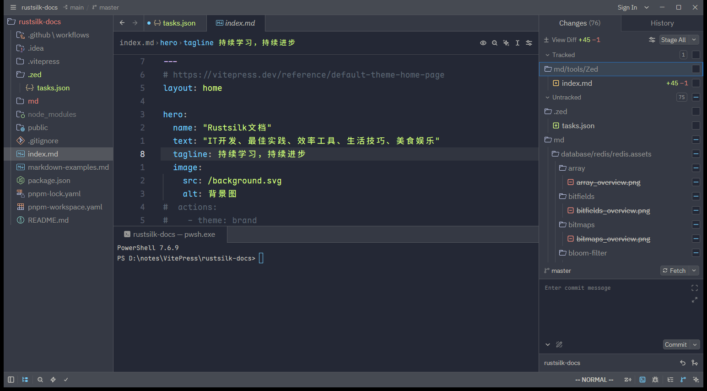

# 概述

Zed 内置 **Git 支持**，让你不离开编辑器就能管理版本控制。核心是 **Git Panel**（显示工作树状态、暂存区、分支信息）和 **Project Diff**（以 multibuffer 形式展示并可编辑所有改动）。你在命令行做的改动会**即时**反映到 Zed 里。Zed 不原生支持的操作，可在集成终端里补上。

## 打开 Git Panel

用动作 `git panel: toggle focus`，或点击状态栏的 Git 图标。面板里一眼可见：当前仓库与分支、哪些文件有改动、每个文件的暂存状态。

下图是 rustsilk-docs 项目打开 Git Panel 的实际效果：顶部 `Changes (76)` 与 `History` 页签、`View Diff` 入口，改动文件按 **Tracked / Untracked** 分组，底部是提交信息输入框与 `Stage All`、`Commit` 按钮。



## 仓库激活机制

- 项目根就是 git 仓库（或其子目录）时，其中所有仓库**立即激活**。
- 项目根不是仓库（如主目录、项目集合文件夹）时，直接位于项目根下的仓库立即激活，更深层的仓库在**打开其内部文件时**才激活。
- 未激活的仓库仍被完整索引、可搜索，只是 git 功能（状态、diff、分支）等待激活。

该行为与 `file_scan_depth` 设置相关：非零值会延迟激活非根目录下的仓库；设为 `0` 则关闭延迟激活，所有发现的仓库立即激活。

## 配置 Git 行为

打开 Settings Editor（`Ctrl+,`，macOS `Cmd+,`），Git 设置分布在两页：

- **Panels > Git Panel**：面板位置、树状/平铺视图、状态显示样式。
- **Version Control**：gutter 指示条、inline blame、hunk 样式。

常见调整：

| 需求 | 位置 |
|------|------|
| 移动 Git Panel（默认左侧） | Panels > Git Panel > Git Panel Dock → 右/下 |
| 树状视图（按文件夹层级） | 面板上下文菜单切 Tree View，或 Panels > Git Panel |
| 关闭/延迟 inline blame | Version Control > Inline Git Blame |
| 隐藏 gutter 增删改色条 | Version Control > Git Gutter > Visibility → Hide |
| 改提交信息换行长度（默认 72） | 搜索 "Git Commit" > Preferred Line Length |

## Project Diff（项目差异）

执行 `git: diff`（`Ctrl+G D`，即先按 `Ctrl+G` 再按 `D`）打开 Project Diff，展示 Git 捕获的所有改动。

> [!important] Project Diff 就是 multibuffer
> Project Diff 里显示的每处改动都是**可编辑的文件 excerpt**，行为与普通 multibuffer 完全一致。你可以在 diff 视图里直接改代码，也能逐个 hunk 或整文件暂存/取消暂存。multibuffer 的用法见 [060.Multibuffers多缓冲](../04.代码编辑与导航/060.Multibuffers多缓冲.md)。

### Word Diff 高亮

默认 Zed 会高亮修改行内**具体变化的词**，便于精确定位改动。全局关闭：Settings Editor > Languages & Tools > Miscellaneous > 关 Word Diff Enabled。仅对特定语言关闭：

```jsonc
{ "languages": { "Markdown": { "word_diff_enabled": false } } }
```

### Diff 视图样式

两种模式：**split**（左右并排，默认）与 **unified**（行内增删）。设置里搜索 "diff view style" 切换，或：

```jsonc
{ "diff_view_style": "unified" }
```

该偏好应用于 Project Diff、File History、Stash Diff View。

## File History（文件历史）

显示单个文件的提交历史，每条含作者、时间戳、提交信息；选中某提交会打开只看该文件在该提交中改动的 diff 视图。打开方式：

- 在 Project Panel / Git Panel 右键文件 → "View File History"
- 右键编辑器标签 → "View File History"
- 命令面板搜索 "file history"

## Fetch / Push / Pull

通过 Git Panel 上的按钮，或命令面板动作 `git: fetch`、`git: push`、`git: pull`。

Zed 遵循 Git 的 push 配置，推送时按序检查：① 当前分支的 `pushRemote`；② Git config 里的 `remote.pushDefault`；③ 分支的 tracking remote。与 Git 标准行为一致。多远程时，Git Panel 会显示 remote 选择器。

## 暂存工作流

Zed 有两种主要暂存方式：

### 用 Project Diff

聚焦到每个 hunk，点标签栏按钮或用 `git: stage and next`（`Alt+Y`，macOS `Cmd+Y`）逐个暂存。`git: stage all`（`Ctrl+Space`，macOS `Cmd+Ctrl+Y`）一次暂存全部，再用 `git: commit`（`Ctrl+Enter`，macOS `Cmd+Enter`）立即提交。

### 用 Git Panel

直接在面板输入提交信息点 commit 按钮（或 `git: commit`），会自动暂存所有已跟踪文件（复选框显示 `[·]`）并提交。

- 单个条目用其复选框暂存；顶部按钮或 `git: stage all` 暂存全部。
- 条目按 **Tracked / Untracked** 分组，可对整组用 `git: stage section` / `git: unstage section`（默认无快捷键，可在 `GitPanel` 上下文里绑定）。
- 右键文件 → **View File** 直接打开（无 diff），或 **Open Diff**（`Ctrl+Enter`）在 diff 视图查看。

## 提交（Committing）

Zed 提供两个提交文本区：

1. Git Panel 底部的输入框，按 `Ctrl+Enter`（macOS `Cmd+Enter`）立即提交所有暂存改动。
2. 用动作 `git: expand commit editor`，或在提交框聚焦时按 `Shift+Esc` 展开为完整提交编辑器。

### 撤销提交

提交后，Git Panel 提交框下方会出现一条显示最近提交的栏，其中的 "Uncommit" 按钮执行 `git reset HEAD^ --soft`，把提交退回工作区。

## 分支管理

- 新建分支：`git: branch`。
- 切换分支：`git: switch` 或 `git: checkout branch`。
- 删除分支：打开 `git: switch`，找到分支用删除选项（Zed 会确认）。**不能删除当前检出的分支**，需先切走。

## Git Worktrees

worktree 让你在磁盘上同时保留同一仓库的多个检出，便于并行处理多个分支/任务而无需 stash 或重建。从标题栏（项目选择器旁）或 `git: worktree` 打开 worktree picker，可以：

- 从当前分支或默认分支创建新的 linked worktree
- 输入名字创建命名 worktree，或让 Zed 自动取名
- 切换当前工作区到已有 worktree
- 在新窗口打开已有 worktree
- 删除未在项目里打开的 linked worktree

> [!note] worktree 与分支
> 新 worktree 以 **detached HEAD** 状态创建。切换过去后，用 worktree picker 旁的分支选择器创建或检出一个未被占用的分支，避免同一分支被多个 worktree 同时检出。新 worktree 目录由 `git.worktree_directory` 控制，默认在仓库工作目录的 `../worktrees`。

创建 linked worktree 后要跑初始化步骤，用 [`create_worktree` 任务 hook](./020.Tasks任务.md#hooks自动触发)。多根工作区（含多个 git 仓库）时，Zed 会为每个仓库创建 linked worktree，非 Git 文件夹原样纳入新工作区。

## 合并冲突（Merge Conflicts）

merge / rebase / pull 后遇到冲突时，Zed 高亮冲突区域并在每处冲突上方显示解决按钮。

- 冲突文件在 Git Panel 里带警告图标；在 Project Diff 里，当前分支改动高亮为**绿色**，传入分支改动高亮为**蓝色**。
- 每处冲突有三个按钮：**Use [当前分支]**、**Use [另一分支]**、**Use Both**（保留双方，当前分支在前）。
- 点击按钮即解决该冲突，移除冲突标记并替换为所选内容。解决完一个文件的所有冲突后，暂存并提交完成合并。

复杂冲突可直接手动编辑文件，删掉 `<<<<<<<`、`=======`、`>>>>>>>` 标记，保留想要的内容。

## Stash（贮藏）

stash 让你临时保存未提交改动、把工作目录恢复干净，适合快速切分支或拉更新。

### 创建 stash

| 动作 | 说明 |
|------|------|
| `git: stash all` | 贮藏暂存与未暂存改动（含未跟踪文件），清空工作目录 |
| `git: stash tracked` | 只贮藏已跟踪改动，保留未跟踪文件 |
| `git: stash staged` | 只贮藏已暂存改动（需 git 2.35+） |

每个动作会先提示输入可选的 stash 名；留空确认则由 git 生成默认的 `WIP on ...` 描述。

### 管理与快速操作

`git: view stash`（或 Git Panel 溢出菜单）打开 stash picker，可查看列表、打开 diff、apply（应用但保留条目）、pop（应用并移除）、drop（删除不应用）。快捷动作：`git: stash apply` 应用最近 stash，`git: stash pop` 应用并移除最近 stash。

在 stash picker 选中某 stash 按 `Ctrl+Shift+V` 查看内容，diff 视图里：apply = `Ctrl+Space`，pop = `Ctrl+Shift+Space`，drop = `Ctrl+Shift+Backspace`。

## Git 里的 AI 支持

Zed 支持用 LLM 生成提交信息：在 Git Panel 的信息编辑框聚焦时，点左下角铅笔图标、执行 `git: generate commit message`、或按 `Alt+L`（macOS `Alt+Tab`）。需先配置 LLM provider（自有 API key 或 Zed 托管模型），见 [06.AI与Agent](../06.AI与Agent/001.AI概述.md)。

可指定该任务偏好的模型：

```jsonc
{
  "agent": {
    "commit_message_model": { "provider": "anthropic", "model": "claude-4-5-haiku" },
    "commit_message_instructions": "Use the Conventional Commits format: <type>(<scope>): <description>."
  }
}
```

全局自定义指令放在 `AGENTS.md`（macOS/Linux：`~/.config/zed/AGENTS.md`；Windows：`%APPDATA%\Zed\AGENTS.md`）。

> [!note] Rules Library 已移除
> Zed v1.4.0 之前通过 Rules Library 配置提交指令，现已移除，改用 `AGENTS.md` 与 `commit_message_instructions`。

## Git 托管集成与 Permalink

Zed 让提交哈希、Issue/PR/MR 引用变成可点击链接，支持 GitHub、GitLab、Bitbucket、SourceHut、Tangled、Codeberg。

- **自托管实例**：若远程 URL 含 `gitlab`、`gitea` 等关键字会自动识别；否则用 `git_hosting_providers` 手动配置（`provider` 支持 `github`/`gitlab`/`bitbucket`/`gitea`/`forgejo`/`sourcehut`/`tangled`/`gitiles`）。

```jsonc
{
  "git_hosting_providers": [
    { "provider": "gitlab", "name": "Corp GitLab", "base_url": "https://git.example.corp" }
  ]
}
```

- **Permalink**：对当前选区用 `editor: copy permalink to line` / `editor: open permalink to line`（命令面板搜 `permalink`，或右键 "Copy Permalink to Line"）。文件标签或 Project Panel 里可 "Open/Copy File Permalink"。

## Diff Hunk 快捷键

查看有改动的文件时，diff hunk 可展开/折叠以便细看：

| 动作 | Windows / Linux | macOS |
|------|-----------------|-------|
| 展开全部 hunk（`editor: expand all diff hunks`） | `Ctrl+"` | `Cmd+"` |
| 折叠全部 hunk | `Esc`（`editor: cancel`） | `Esc` |
| 切换选中 hunk（`editor: toggle selected diff hunks`） | `Ctrl+'` | `Cmd+'` |
| 在 hunk 间导航 | `editor: go to hunk` / `go to previous hunk` | 同左 |

## 常用动作速查

| 动作 | Windows / Linux | macOS |
|------|-----------------|-------|
| `git: stage all` | `Ctrl+Space` | `Cmd+Ctrl+Y` |
| `git: unstage all` | `Ctrl+Shift+Space` | `Cmd+Ctrl+Shift+Y` |
| `git: toggle staged` | `Space` | `Space` |
| `git: stage and next` | `Alt+Y` | `Cmd+Y` |
| `git: commit` | `Ctrl+Enter` | `Cmd+Enter` |
| `git: push` | `Ctrl+G ↑` | `Ctrl+G ↑` |
| `git: force push` | `Ctrl+G Shift+↑` | `Ctrl+G Shift+↑` |
| `git: pull` | `Ctrl+G ↓` | `Ctrl+G ↓` |
| `git: pull rebase` | `Ctrl+G Shift+↓` | `Ctrl+G Shift+↓` |
| `git: fetch` | `Ctrl+G Ctrl+G` | `Ctrl+G Ctrl+G` |
| `git: diff` | `Ctrl+G D` | `Ctrl+G D` |
| `git: restore` | `Ctrl+K Ctrl+R` | `Cmd+Alt+Z` |
| `git: worktree` | `Alt+Ctrl+Shift+W` | `Cmd+Ctrl+W` |
| `git: blame` | `Alt+G B` | `Cmd+Alt+G B` |

> [!tip] 无默认键位的动作
> `git: add`、`git: branch`、`git: switch`、各类 `git: stash *` 等默认没有快捷键，可在 `keymap.json` 里自行绑定，见 [030.键位绑定Keybindings](../03.配置与键位自定义/030.键位绑定Keybindings.md)。

## 用 Zed 作为 Git 提交编辑器

命令行提交时想用 Zed 编辑提交信息：

```sh
git config --global core.editor "zed --wait"
```

或在 shell 环境（`~/.zshrc`、`~/.bashrc` 等）里 `export GIT_EDITOR="zed --wait"`。`--wait` 让 Zed 阻塞直到你关闭该文件，git 才继续。CLI 详见 [050.故障排查与CLI](../08.协作远程与参考/050.故障排查与CLI.md)。

# 引用

1. Git：<https://zed.dev/docs/git>
2. Multibuffers：<https://zed.dev/docs/multibuffers>
3. Tasks（hooks）：<https://zed.dev/docs/tasks>
4. AI Quick Start：<https://zed.dev/docs/ai/quick-start>
