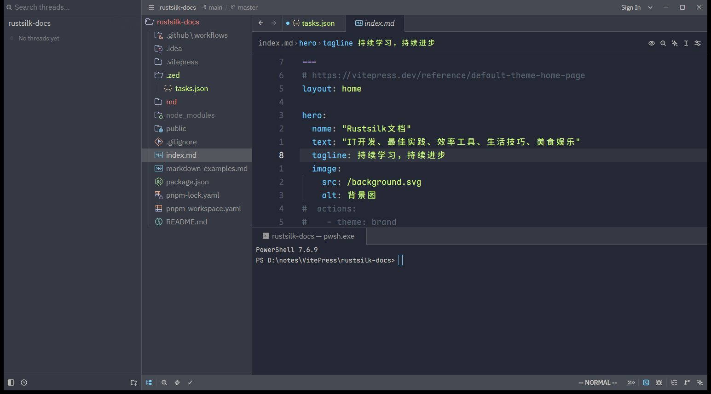

# 概述

**Agent Panel** 是你与 AI agent 交互的地方——这些 agent 能读、写、运行你项目里的代码。它是 Zed AI 编码体验的核心，适用于代码生成、重构、调试、写文档与一般问答。

打开方式：命令面板执行 `agent: new thread`，或点击状态栏的 ✨ 图标（默认键位 `Ctrl+Shift+A`，macOS `Cmd+Shift+A`）。

下图是打开 Agent Panel 后的实际界面：左侧为 Threads Sidebar（按项目分组管理线程，`Ctrl+Alt+J`），右侧是新线程空状态；因为接入的是 External Agent（Qwen Code，ACP 集成），未认证时会显示认证入口。

## 开始使用

首次使用需先配置一个模型（Zed Agent）或一个 External Agent：

- **LLM Providers**：Zed 托管模型、API access、订阅、网关、本地模型。
- **External Agents**：ACP 集成的 agent。

配置好后，在消息编辑框输入内容按 `Enter` 提交；需要更大输入空间用 `Shift+Alt+Esc` 展开编辑框。响应会流式返回，并显示模型正在调用哪些工具的指示。

> [!note] External Agent 的功能差异
> 部分 Agent Panel 功能（历史恢复、检查点、token 用量显示等）依赖具体 agent 集成，并非每个 External Agent 都支持。

## 线程（Threads）

Agent Panel 以「线程」组织对话，默认使用 Zed 第一方 agent。

### 新建线程

- `Ctrl+N`（macOS `Cmd+N`）新建线程。
- 用 agent 选择器（空状态左侧）或面板右上角 `+` 图标打开 "New Thread…" 菜单（`Ctrl+Alt+Shift+N`）。菜单里可：
  - 选 **Zed Agent** 或已安装的 **External Agent** 开新线程。
  - **New From Summary**：用当前对话的摘要开一个新的 Zed Agent 线程——接近上下文窗口上限时用来「压缩」长线程很实用。
  - **Terminal**：直接在 Agent Panel 里开一个 terminal thread。
- `agent: new external agent thread`：用指定 External Agent id 开新线程。

### 管理多个线程

可同时跑多个 agent 线程，各自独立拥有 agent、上下文窗口与对话历史。

- **Threads Sidebar**（`Ctrl+Alt+J`，macOS `Cmd+Alt+J`）：按项目分组查看所有线程，点击切换。
- **线程切换器**（`Ctrl+Tab`）：不打开侧边栏在最近线程间循环。
- **归档**：侧边栏悬停点归档图标，或选中按 `Shift+Backspace`。Thread History 保留所有项目的所有线程，按时间排序，可随时恢复。
- **文件冲突隔离**：若两个线程可能改同一批文件，可把其中一个隔离到新的 Git worktree（用标题栏 worktree picker 选择或新建）。

### 线程标题

标题根据对话内容自动生成，可点标题手动改，或用右上角省略号菜单里的 "Regenerate Thread Title" 重新生成。

## 编辑与排队消息

- **编辑消息**：你发给模型的任意消息都可编辑。点击消息卡片，调整 prompt 或增删上下文后重新提交。
- **排队消息**：agent 生成期间发送的消息默认排队，生成结束后发出。若想让排队的消息更早送达（在下一步、通常在某次工具调用与响应之间打断它），对该消息开启 **Steer**（仅 Zed Agent 支持）。可编辑或删除排队消息，也能点 stop 按钮或对排队消息 "Send Now"（双击 Enter）立即打断。

## 检查点（Checkpoints）

模型每次执行编辑后，你的消息顶部会出现 **Restore Checkpoint** 按钮，可把代码库恢复到该消息之前的状态。即使你中途打断了编辑，该按钮也会出现——这正是你发现 agent 方向不对、想回退的时刻。

## 审阅改动（Review Changes）

agent 改完项目后，面板会显示改了哪些文件、多少文件、多少行。

- 展开消息编辑框上方的折叠条，或点 **Review Changes** 按钮（`Ctrl+Shift+R`，macOS `Shift+Ctrl+R`），打开一个特殊的 multibuffer 标签，列出所有改动。
- 可**逐个 hunk** 或**整批**接受/拒绝改动。
- 设 `agent.single_file_review: true` 可让 diff 直接内联显示在各文件里，带同样的 keep/reject hunk 控件（审阅期间临时覆盖该 buffer 的 git diff）。

> [!tip] 审阅就是 multibuffer
> Review Changes 用的是 multibuffer，你可以在里面直接编辑、用多光标批改，再决定接受与否。multibuffer 用法见 [060.Multibuffers多缓冲](../04.代码编辑与导航/060.Multibuffers多缓冲.md)。

## 添加上下文（Adding Context）

agent 能自动搜索代码库找上下文，但**显式提供**能提升质量、降低延迟。在消息编辑框输入 `@`，可提及：文件、目录、符号、历史线程、[skills](./040.Skills与Instructions.md)、诊断、分支 diff、要抓取的 URL。

- 从 buffer 复制的多行代码粘贴进来时，Zed 自动格式化为带文件上下文的 @-mention；想粘贴纯文本用 `Ctrl+Shift+V`（macOS `Cmd+Shift+V`）。
- **选区作为上下文**：在 buffer 或终端选中文本，用 `Ctrl+>`（macOS `Cmd+>`）、`agent: add selection to thread`、或 `+` 菜单里的 "Selection" 加入。
- **图片作为上下文**：支持 vision 模型的 provider（GPT-4o+、Claude 3+、Gemini 1.5/2.0、Bedrock vision 等）可附图。@-mention 项目里的图片、从文件系统拖入消息框、或复制粘贴图片均可。

## Token 用量与压缩（Compaction）

面板消息编辑框附近（profile 选择器旁）显示当前活动线程消耗的 token。

- Zed Agent 线程接近设定阈值时会**自动压缩**：把较早消息总结成摘要替换进上下文，腾出空间。线程里会出现可展开的 **Context Compacted** 条目。也可输入 `/compact` 手动压缩。
- 若所选模型上下文窗口太小（< 80000 tokens）不足以自动压缩，接近上限时会出现横幅，用 **Start New Thread** 或 **New From Summary** 继续，或在新线程里 @-mention 旧线程。
- 用 `agent.auto_compact` 配置自动压缩。

## 切换模型

配置好 LLM providers 后，点消息编辑框的模型选择器或用 `Ctrl+Alt+/`（macOS `Cmd+Alt+/`）切换模型。

> [!warning] 注意 provider
> 同一模型可能由多个 provider 提供（如 Claude Sonnet 4.5 可经 Zed Pro、OpenRouter、Anthropic 直连等）。认准模型选择器里模型左侧的 **provider logo**，选对 provider。

**收藏模型**：模型选择器里悬停点星号，或用 `agent.favorite_models` 设置。用 `Alt+Tab`（macOS `Alt+L`）在收藏间循环，无需打开选择器。

## 工具与 Profiles

Agent Panel 支持工具调用（tool calling），这是「agentic editing」的基础。Zed 内置工具用于搜索代码库、编辑文件、运行终端命令等。

- **Agent Profiles**：选择 Zed Agent 线程里可用哪些内置工具与 MCP 工具。
- **Tool Permissions**：控制受权限约束的工具调用是允许、拒绝还是确认。
- **MCP Servers**：添加外部工具，见 [030.MCP服务器](./030.MCP服务器.md)。

> [!note] 模型是否支持工具
> 工具调用需模型与 provider 各自支持。有些模型即便有内置工具也无法调用，此时会显示 "No tools" 标签。所有 Zed 托管模型都开箱支持工具调用。

## 跟随 agent 与通知

- **跟随**：点面板左下角的十字准星图标，编辑器会跳到 agent 触碰的每个文件；也可提交消息时按住 `Ctrl`（macOS `Cmd`）自动跟随。
- **保持唤醒**：线程运行时 Zed 会请求系统不要 idle-sleep（显示器仍可关、屏幕仍可锁），用 `agent.prevent_idle_sleep` 关闭。
- **通知**：把 Zed 切到后台后，可在生成结束时收到桌面通知或声音，用 `agent.notify_when_agent_waiting` 与 `agent.play_sound_when_agent_done` 配置。

## 错误排查与反馈

- 遇到错误或异常行为，用 `agent: open active thread as markdown` 把线程导出为 Markdown 附到 GitHub issue。
- **反馈**：可为响应点赞/点踩帮助改进 Zed 的 system prompt 与工具。

> [!warning] 评分会上报对话
> 给 AI 响应评分会把整个对话线程（你的消息、AI 响应、线程元数据）发送给 Zed。**若不希望数据存到 Zed 服务器，就不要评分。** Zed 不会在你未显式评分的情况下收集数据用于改进 agent。详见 [070.AI隐私与安全](./070.AI隐私与安全.md)。

# 引用

1. Agent Panel：<https://zed.dev/docs/ai/agent-panel>
2. Parallel Agents：<https://zed.dev/docs/ai/parallel-agents>
3. Agent Profiles：<https://zed.dev/docs/ai/agent-profiles>
4. Tools：<https://zed.dev/docs/ai/tools>
